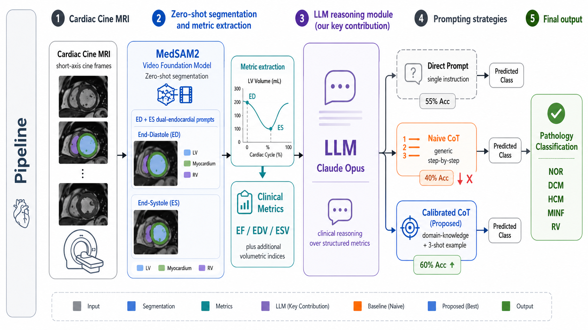
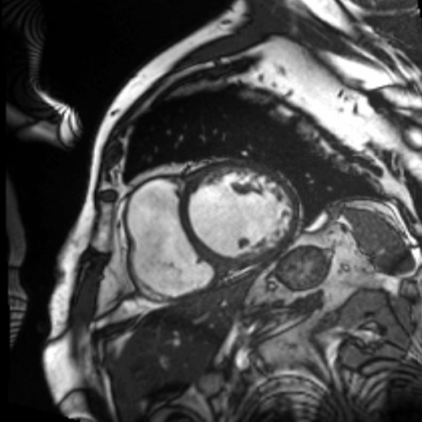
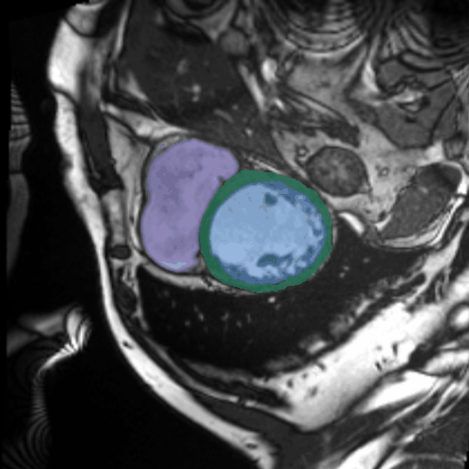
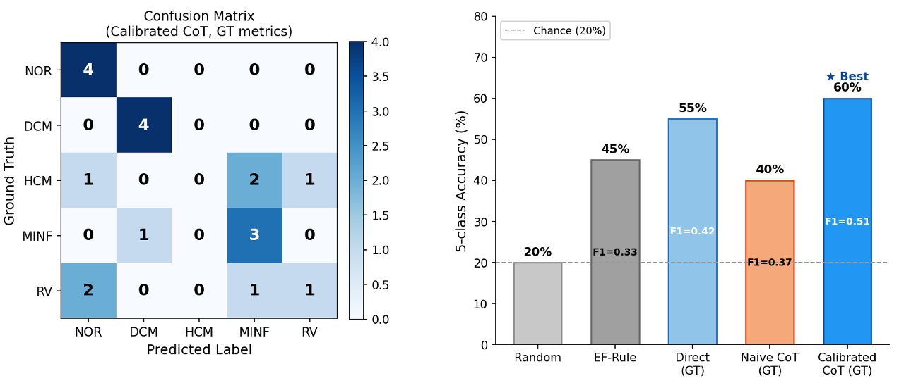

# Clinically Calibrated LLM Reasoning for Zero-Shot Cardiac Pathology Classification

[](https://www.python.org/)
[](LICENSE)
[](https://www.anthropic.com/)
[](https://www.creatis.insa-lyon.fr/Challenge/acdc/)

Can a large language model turn cardiac MRI **measurements** into a **diagnosis** — with zero
task-specific training?

This repository evaluates an LLM (Claude Opus) as a **retraining-free reasoning layer** on top of
an automated cardiac MRI pipeline: zero-shot segmentation (MedSAM2) → LV clinical metrics
(EF / EDV / ESV) → LLM reasoning → one of five pathology classes
(NOR · DCM · HCM · MINF · RV), on the ACDC validation cohort.

<p align="center">
  
</p>

### The example case, end to end

A real ACDC validation patient (dilated cardiomyopathy). Left: the cine input. Right: MedSAM2
dual-anchored **zero-shot** segmentation propagated across the full cardiac cycle (LV blue ·
myocardium green · RV purple). From these masks: EF 14%, EDV 352 mL, ESV 304 mL → the
calibrated LLM answers **DCM** — correctly.

|             Cine input (looping)             |            Zero-shot segmentation, all frames            |
| :-------------------------------------------: | :------------------------------------------------------: |
|  |  |

## TL;DR — three findings

1. **It works, modestly:** direct prompting beats an EF-threshold rule
   (55% vs 45% five-class accuracy, chance = 20%).
2. **Naive "think step-by-step" makes it *worse*** (55% → 40%): unconstrained chain-of-thought
   over-interprets borderline measurements. Anchoring the same reasoning to **explicit clinical
   thresholds** plus one worked example recovers and wins: **60% accuracy, macro-F1 0.510**.
3. **An honest negative result:** HCM is never recovered — **F1 = 0.000 for every prompting
   strategy** — because LV cavity volumetrics cannot encode a wall-thickness disease. The
   diagnostic ceiling is set by the **input biomarkers**, not by the model.

## Results

ACDC validation cohort, n = 20, five balanced classes, reference-derived (GT) metrics:

| Method                              |           Accuracy |        Macro-F1 |
| ----------------------------------- | -----------------: | --------------: |
| Random                              |              20.0% |              — |
| EF-threshold rule                   |              45.0% |           0.325 |
| Direct prompt                       |              55.0% |           0.425 |
| Naive CoT ("step-by-step")          | **40.0% ↓** |           0.369 |
| **Calibrated CoT (proposed)** |    **60.0%** | **0.510** |

Per-class F1 (Calibrated CoT): NOR 0.727 · DCM 0.889 · **HCM 0.000** · MINF 0.600 · RV 0.333

<p align="center">
  
</p>

**Measurement noise compounds.** Re-running the same six conditions on MedSAM2-*predicted*
metrics (instead of reference-derived) drops Calibrated CoT from 60% → 40%: the reasoning layer
inherits every upstream segmentation error. Full six-condition results, including the
predicted-metric arms, are in [`results/llm_results.json`](results/llm_results.json):

| Condition | Metrics source | Prompting                |        Accuracy |        Macro-F1 |
| --------- | -------------- | ------------------------ | --------------: | --------------: |
| A         | GT             | Direct                   |           55.0% |           0.425 |
| B         | GT             | Naive CoT                |           40.0% |           0.369 |
| E         | GT             | **Calibrated CoT** | **60.0%** | **0.510** |
| C         | Predicted      | Direct                   |           50.0% |           0.372 |
| D         | Predicted      | Naive CoT                |           30.0% |           0.269 |
| F         | Predicted      | Calibrated CoT           |           40.0% |           0.369 |

## Why naive CoT fails — and what "calibrated" means

Asked to "reason step by step" over EF/EDV/ESV, the model invents its own reference ranges
mid-reasoning and talks itself out of correct answers on borderline cases. The **calibrated**
prompt keeps the step-by-step structure but pins each step to explicit diagnostic criteria
(e.g., DCM: EF < 45% **and** EDV > 180 mL) and shows one worked example. The three exact prompt
templates are in [`prompts/`](prompts/):

- [`prompts/direct.txt`](prompts/direct.txt) — single-instruction classification
- [`prompts/naive_cot.txt`](prompts/naive_cot.txt) — generic stepwise assessment
- [`prompts/calibrated_cot.txt`](prompts/calibrated_cot.txt) — threshold-anchored reasoning + one-shot example

## The HCM negative result

Hypertrophic cardiomyopathy thickens the **myocardial wall** while the LV **cavity** — the only
thing EF, EDV and ESV describe — can look normal. Accordingly, every prompting strategy scores
F1 = 0.000 on HCM: the four HCM cases scatter to NOR, MINF and RV, never to HCM. This is an
input-level information bottleneck, not a prompting failure, and it motivates the roadmap below.

## Quickstart

```bash
git clone git@github.com:zhuoanli/llm-cardiac-pathology.git
cd llm-cardiac-pathology
pip install -r requirements.txt

export ANTHROPIC_API_KEY="sk-..."   # https://console.anthropic.com/
python llm_cardiac_classify.py      # runs all 6 conditions (~240 API calls), writes results/llm_results.json
python plot_results.py              # regenerates figures/results.png
```

The committed [`results/llm_results.json`](results/llm_results.json) is the exact run reported
above, including every raw LLM response (`records[*].llm_output`) — the full reasoning traces
are auditable without spending API credits.

## Repository structure

```
├── llm_cardiac_classify.py   # main experiment: 6 conditions × 20 patients
├── plot_results.py           # confusion matrix + accuracy figure
├── prompts/                  # the three prompt templates (verbatim)
├── data/
│   ├── metrics_acdc_val.json # per-patient EF/EDV/ESV (GT + MedSAM2-predicted) + Dice/HD95
│   └── README.md             # data provenance
├── results/
│   └── llm_results.json      # full results incl. raw LLM outputs for all 240 calls
└── figures/                  # pipeline + results figures
```

## Scope and limitations

- **Proof-of-concept cohort:** n = 20, deliberately class-balanced (4 per class). The trustworthy
  findings are the *ordering* (naive CoT < direct < calibrated) and the HCM zero — not the
  absolute 60%.
- Headline numbers use **reference-derived metrics** to isolate the reasoning layer; the
  predicted-metric arms quantify how segmentation error compounds.
- Single LLM (`claude-opus-4-7`), single run; thresholds in the calibrated prompt are
  representative textbook values, not fitted to the cohort's labels.
- Not a medical device; research code only — no clinical use.

**Roadmap:** morphology-aware inputs computable from the same masks (wall thickness, myocardial
mass, strain, RV volumes) to attack the HCM bottleneck, then larger multi-center validation.

## Related repositories

- [4DCMR-Segmentation-via-Foundation-Model](https://github.com/zhuoanli/4DCMR-Segmentation-via-Foundation-Model) —
  the upstream zero-shot segmentation pipeline (MedSAM2, dual-anchored propagation) that produces
  the metrics used here.
- [CycleQA](https://github.com/zhuoanli/CycleQA) — label-free quality assurance for the same
  zero-shot segmentation under cross-vendor shift.

## Citation

```bibtex
@inproceedings{li2026llmcardiac,
  author    = {Li, Zhuoan},
  title     = {Large Language Model Reasoning for Cardiac Pathology Classification
               from Segmentation-Derived Metrics},
  booktitle = {Medical Image Understanding and Analysis (MIUA)},
  publisher = {Springer},
  year      = {2026}
}
```

## Acknowledgments

[ACDC dataset](https://www.creatis.insa-lyon.fr/Challenge/acdc/) (Bernard et al., IEEE TMI 2018) ·
[MedSAM2](https://arxiv.org/abs/2408.00874) (Zhu et al., 2024) ·
[SAM 2](https://arxiv.org/abs/2408.00714) (Ravi et al., 2024) ·
[Claude](https://www.anthropic.com/) (Anthropic)

## Contact

Zhuoan Li · Weldon School of Biomedical Engineering, Purdue University · li4533@purdue.edu
